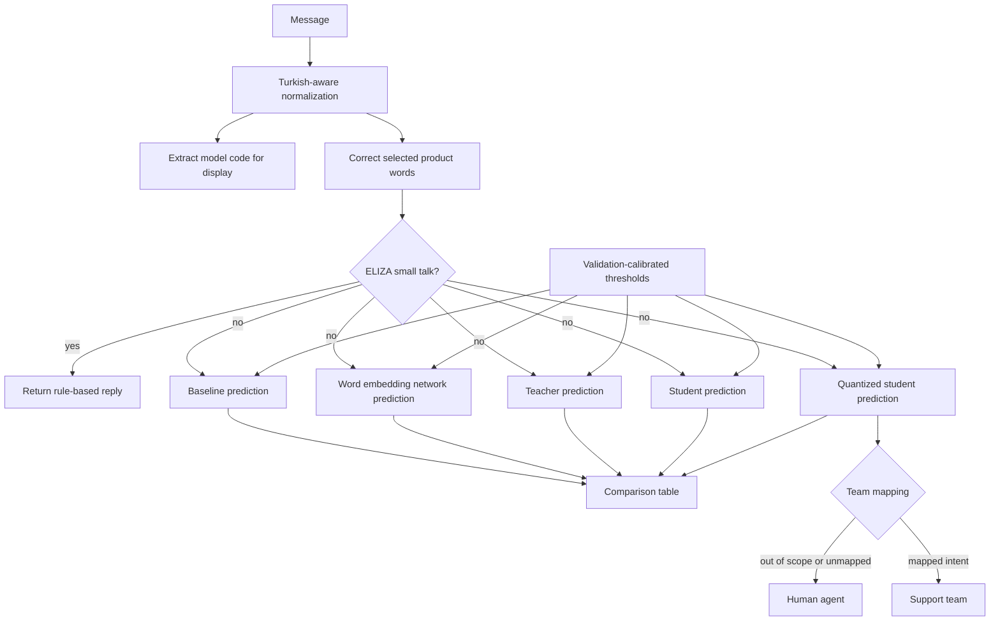

# Architecture

The data preparation script combines a fixed-seed, intent-stratified appliance split with the original MASSIVE splits. It excludes held-out MASSIVE intents from training and labels those intents `out_of_scope` in validation and test. Every model learns from the combined training split. After training, calibration selects one threshold per model using validation confidence scores. Evaluation uses these thresholds and the same test file for every model. In the app, the quantized student determines the route. The extracted code is displayed without being removed from the message.
