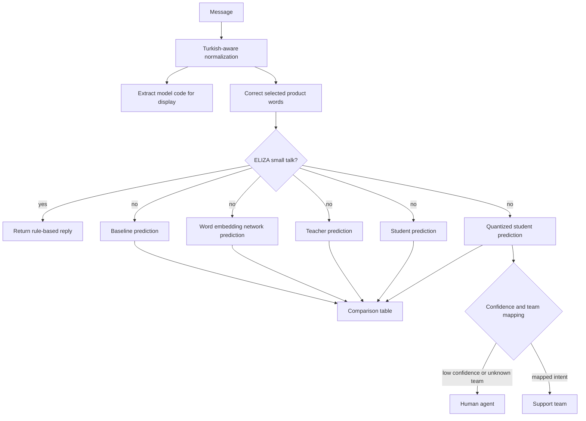

# Architecture

Preparation excludes held-out intents from train and validation, relabels them in test, and adds appliance messages to test. All evaluation models use that test file and the same confidence rule. Preprocessing in the app precedes model inference; the model code is displayed without being removed from the message.
