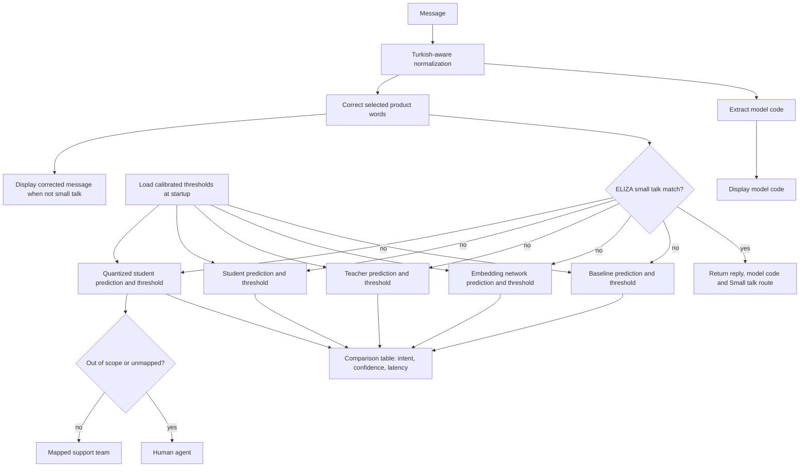

# Architecture

The app loads all models and their validation-calibrated thresholds at startup. Each model normalizes its input again before predicting; the app applies product correction before inference. The model code is displayed without being removed from the input. The quantized student's thresholded prediction determines the route; mappings use an exact intent or its prefix.

The data preparation script combines a fixed-seed, intent-stratified appliance split with the original MASSIVE splits. It excludes held-out MASSIVE intents from training and labels those intents `out_of_scope` in validation and test. Every model learns from the combined training split. After training, calibration selects one threshold per model using validation confidence scores. Evaluation uses these thresholds and the same test file for every model, then saves up to ten quantized-student errors in test order.
